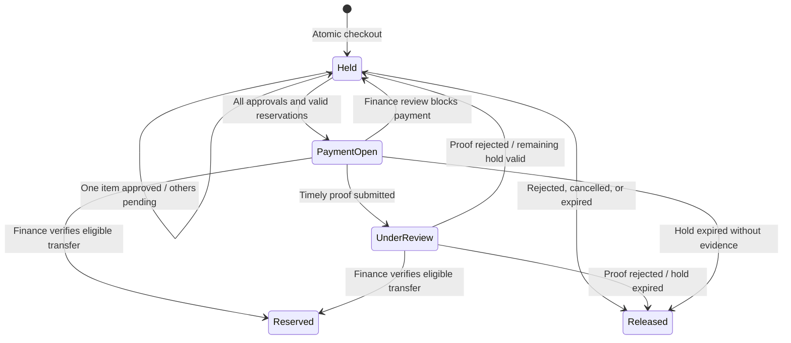
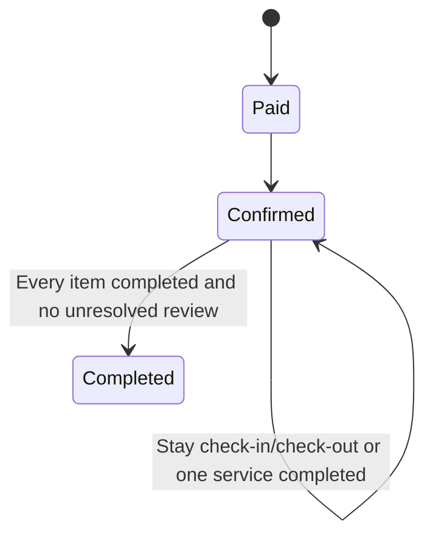

# Stay V2 Phase 4B — Unified Order Gate

## Checkout and authorization

One existing `booking_orders` row, one booking code and the shared Finance ledger serve each checkout. The five migrations install the gate first, adapt the shared checkout, add per-item Finance review and protect timely evidence and approval locking. The first SQL gate smoke ran before the Phase 3 guard was scoped to allow an explicitly marked, unsealed mixed parent.

Allowed combinations are Stay Partner + scheduled Trip, Stay Partner + Experience, Trip + Experience, and all three. Phase 4B accepts one item per service per mixed checkout. A customer account is required, as in the existing Experience path. Existing guest checkout continues through the legacy paths. The API and entry points use `NEXT_PUBLIC_SHIAP_UNIFIED_CHECKOUT=true` in QA. The default is off.

The existing idempotent checkout RPC remains service-role-only. A private marker is written by the same SQL transaction that uses the existing price and inventory code. It is inaccessible to clients. Stay inventory uses the nightly calendar, Trip uses the selected departure, and scheduled Experience uses the selected session. Request-only Experience without a session relies on its existing guest limits and operational approval, with no pooled inventory invented. Failure rolls back the parent, all lines, and inventory. The mixed engine acquires Experience session, Stay inventory and Trip departure in a consistent order when present. Approval locks the parent before service resources. Resource contention rejects safely and can be retried using the same key.

Commercial snapshots retain product, vendor, unit price, subtotal, Service Fee and the Stay Partner agreement/version with a 15% commission rule. Separate discount and tax are zero under the current pricing contract. Stay uses its verified Places identity as vendor. Trip and Experience use the configured catalog vendor contact ID when available and SHIAP otherwise. The snapshot stores identifiers, not contact details. Only the Stay partner sees their existing authorized fulfillment workflow. No commission accounting entries are generated.

## Approval and payment

Unpaid reservations have a bounded hold at creation. Orders requiring approval use up to 24 hours. Instant mixed orders use 15 minutes. Item approval cannot extend a sealed deadline. A proof submitted before expiry keeps the entire reservation in the existing payment-review state, including after the review target if still unresolved. Finance must make an explicit review decision. Late evidence cannot start that reservation protection. An overdue transfer without eligible evidence requires Finance reconciliation.

The database recalculates eligibility when payment opens, proof is submitted, or a receipt or Paid state is written. The customer detail calls the same check before showing instructions. Mixed-order notifications direct customers to the authenticated booking page for bank details. Phase 4A continues to allocate a unique bank transaction, update Paid and record a single receipt atomically. A dispute, stale hold, broken capacity or inactive Partner configuration prevents payment. Eligible pending evidence uses its submission time for elapsed-service comparisons while checking current inventory and operational eligibility.

## Fulfillment

Stay preserves Phase 3 fulfillment and check-out validation. Admin records Trip or Experience fulfillment after the applicable departure or session period. For date-only activities the period ends at midnight WITA after the service date. The parent trigger prevents the existing generic Admin completion command from skipping a line. Unpaid rejection releases the full order. Paid reservations needing an item adjustment enter the Finance review queue. Phase 4B blocks receipt-level partial refunds and parent-level discounts for mixed orders. Item snapshots and stable booking-item IDs provide the Phase 4C reference.

## Modified RPCs and boundaries

| Entry point | Phase 4B handling |
| --- | --- |
| `checkout_booking` | Accepts the explicit unified type and reuses existing idempotency and service pricing cores. |
| `create_booking_order`, `create_experience_booking_order` | Existing public wrappers select legacy mode, with their original access rules. |
| `admin_review_experience_request` | Locks the parent and rejects expired approvals. A mixed approval records only the Experience decision before running the gate. |
| `manage_stay_partner_item` | Keeps Partner authorization and item transitions. Calls the common payment/completion logic for mixed parents. |
| `submit_booking_payment_proof`, `finance_verify_bank_transfer`, existing Finance settlement helpers | Keep their contract. Database guards protect proof insertion, receipt creation and Paid even through direct RPC calls. |
| `admin_update_booking_status`, cancellation and expiry jobs | Keep their contract. Parent/payment triggers enforce mixed fulfillment and protect timely pending evidence. |
| `admin_complete_unified_service` | Admin-only Trip/Experience fulfillment after the applicable service period. |
| `admin_review_unified_service`, `admin_list_unified_service_reviews` | Admin-only review queue and audit. Recording reviews cannot move money. |
| `server_unified_booking_view` | Service-role-only projection. Customer route checks order ownership before requesting it. |

QA is the isolated local instance on port 57322. The production project, old Docker database and schedule lockdown are outside this migration scope. Phase 4C must add item-level refund allocation and reconciliation before enabling any partial refund.

## QA results

- The gate smoke passed before allowing marked mixed orders. The mixed suite passed all four combinations, both approval orders, expired Stay and Trip, rollback after a downstream capacity failure, timely evidence after expiry, cross-order bank reuse, duplicate receipt rejection, pending evidence cancellation protection, and three-item fulfillment.
- Concurrent checkout left one parent with three items. Concurrent approvals from the authorized Stay owner and Experience Admin logged one activation. A verified owner of another property was denied.
- 12 SQL/RLS suites passed including the Phase 3, Phase 4A, guest, Experience, Finance, Service Fee, Places billing and Notifications regressions. Test mutations used synthetic data and rolled back or ran in disposable database clones.
- 56 unit tests, TypeScript, ESLint and local Webpack production build passed. ESLint retained one baseline image warning.
- Chrome ran the standalone build at 320, 375, 390, 430, 768, 1024 and 1280 pixels. Cart and booking detail used synthetic browser fixtures. Separate HTTP smoke checked unauthenticated creation and inaccessible booking details. The authenticated checkout and Finance transitions were exercised at the SQL/RPC layer.
- The local history has 81 versions including Phase 4A and the five Phase 4B migrations `20261121103000`, `20261121103100`, `20261121103200`, `20261121103300` and `20261121103400`. The schedule lockdown version remains unapplied.
