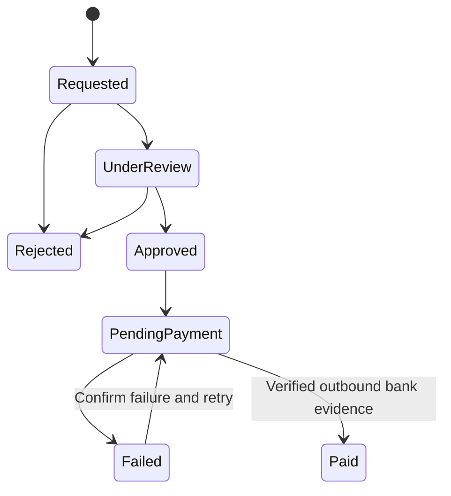
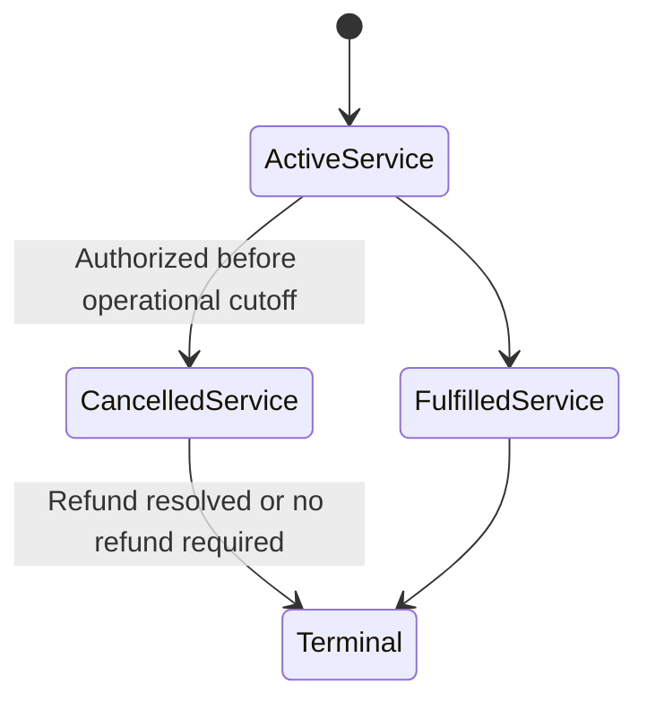

# Stay V2 Phase 4C — Item refunds and reconciliation

## Audit before implementation

- Booking refunds use `finance_record_transaction`, the Finance Server Action and the posted booking ledger. Phase 4B already rejects both parent refunds and parent discounts for mixed orders in `aa_unified_receipt_gate`. Keep that denial unless a database-validated payout targets the same item, amount and order.
- Premium invoices use `admin_refund_places_invoice` and the separate Places cash ledger. They cannot target booking orders. Legacy single-service refunds remain parent-scoped.
- `finance_reconcile_bank_payment` may reverse an unfulfilled booking receipt under Phase 4A. Before exposing item refunds, prevent reversing a mixed receipt once an item has been cancelled or a refund is outstanding or paid.
- Customer cancellation, the Admin parent-status RPC, Experience rejection, Stay rejection, and hold expiry change the parent. Mixed paid parent cancellation remains blocked except when every item is explicitly cancelled through the item workflow. Cancellation and refund each have independent state.
- Capacity comes from order/item joins in Trip inventory, nightly Stay inventory and Experience session inventory. These joins previously counted every item in a paid parent. Exclude cancelled items only and keep all historical item rows.
- The existing service profit view allocates a parent's refund proportionally across services and prorates the Service Fee. That is incompatible with item refunds. Mixed orders need exact item principal allocation and a retained Service Fee. Legacy Finance calculations are kept for other orders.
- Parent booking totals, payment evidence, Stay agreement/commission snapshots, invoice history and the existing outbox stay authoritative. Add item refund events to the outbox. Payout completion must be emitted only after a posted, item-bound ledger adjustment.

## Model and accounting

The existing immutable commercial snapshot is the allocation root. Each refund stores the parent, item, service, vendor, original allocated amount, principal cap, requested/approved/paid figures, policy version, reason, reviewer and timestamps. The bank payout table links one recorded outgoing transaction to one refund and to the original Phase 4A incoming allocation. Finance receives a matching posted ledger entry in the same transaction. Separate append-only action rows record every decision and provide request-key idempotency.

The v1 QA policy caps a refund at the item's paid service principal after discounts. The Service Fee and separately collected tax stay allocated and are excluded from the refund cap. The Phase 4B pricing contract records zero separate discount and tax, and integers for the principal and aggregated Service Fee. Each item has a distinct service category. Item principal plus item fees reconcile exactly to the parent without re-allocating rounding differences. A review is required to decide what the customer is actually owed under their service and agreement terms.

The accounting view separates original customer payment, requested principal, approved liability, posted refunds and remaining value. Stay Partner shows original and remaining commission and vendor-share calculations only. Commission is rounded down to a whole rupiah against the remaining principal. Stay Partner principal and projected commission do not count as recognized SHIAP revenue in the unified view during this phase. Cancelled-item retained cash appears in the reconciliation allocation without automatic revenue recognition. Legacy parent/refund and Premium subscription reports retain their existing treatment.

Example. A Trip item has Rp250.000 principal and Rp3.500 Service Fee. Approval for Rp200.000 creates an Rp200.000 liability with Rp0 bank outflow. After Finance records the successful transfer, Rp200.000 is posted and Rp53.500 remains allocated to Trip including the retained fee. Stay and Experience amounts remain unchanged. A Stay gross principal of Rp300.000 with Rp50.000 executed refund leaves Rp250.000 principal, Rp37.500 projected commission and Rp212.500 projected vendor share.

## State machines

Requests reserve their full requested amount. Approval replaces that reservation with the approved amount. Failed attempts retain the liability, and a recorded transfer moves the amount to posted refunds. Review of an already posted transfer is a reconciliation exception with history. The ledger remains immutable. An actual bank return or an approved amount later disputed needs a separately evidenced correction policy. This phase does not credit a reversed payout or depend on assuming a failed transfer returned funds.

Stay blocks new cancellation after check-in. Trip uses departure time. Scheduled Experience uses the session start. Date-only Experience uses midnight WITA on the service date. An already checked-in voucher blocks the item cancellation. Cancellation releases only the selected item's inventory, revokes only its unused voucher and leaves other services active. All cancelled items make the parent Cancelled and preserve the historical Paid status. A combination of fulfilled and cancelled items can complete only once all operational and refund obligations for the cancelled items have resolved. Partial refund on an active item does not imply cancellation or fulfillment.

## Interfaces and security

- Finance uses `admin_manage_unified_refund` and `admin_unified_refund_report`. Both enforce the existing SHIAP Admin authorization database-side. The Admin UI links the Finance queue to order/item context and private evidence, and displays append-only decision history. This installation uses the existing Admin role for Finance. Role separation and bank-return compensation can be reviewed before deployment.
- The existing customer booking detail API reads a safe item projection after ownership validation. Existing Stay Partner Operations reads only authorized property rows and includes the refund status and amounts for the operator's own item. Bank identifiers, documents, and Finance notes stay private.
- The Admin Calendar filters individually cancelled items using an Admin-only batch RPC. Trip, Stay and Experience capacity functions exclude cancelled item reservations while retaining their historical rows.
- Notification events for requested, approved/rejected, paid and item cancelled use the existing outbox. Email follows the configured event preferences. Partner email is scoped to verified Stay owners and never includes the customer name or parent payment. The paid event requires a posted ledger adjustment. QA uses synthetic queue entries without sending.
- Payouts are manual. Finance verifies a bank-issued outbound ID and the customer beneficiary against the evidence, then uploads the applicable statement to private storage. Duplicate stable IDs are rejected for the official source account. Historical legacy references do not provide an authoritative cross-ledger outbound namespace. Suspicious legacy collisions and bank-account changes require reconciliation.

## Local rollout

Only the isolated QA database on port 57322 is in scope. Phase 4C migrations are `20261121104500`, `20261121104600`, `20261121104700`, `20261121104800`, `20261121104900` and `20261121105000`. Production, the old Docker database and the pending schedule-lockdown migration are outside scope.

Phase 5 can consume the item allocations, commission snapshots, actual refunds and exception flags in QA. Partner earnings and withdrawals still require their own immutable ledger, explicit treatment of cancelled retained proceeds and a verified compensating-entry process for real bank returns.

## QA evidence

- 58 unit tests and 13 SQL/RLS suites passed. Regression coverage included the Phase 4A and 4B gates, legacy booking and guest checkout, Stay Phase 3, Experience, Places billing, notification eligibility, Finance costs and profit, and Service Fee.
- Two simultaneous requests could not reserve more than the item's balance. Competing approvals left one Rp240.000 liability and no posted refund. Concurrent reuse of one outbound statement reference posted exactly one refund.
- For customer and Finance layouts, Chromium passed at 320, 375, 390, 430, 768, 1024 and 1280 pixels. The Finance session used local Supabase Auth. The customer page used a synthetic API response. Financial mutations and notification eligibility were verified through QA database tests.
- The original verified receipt and commission snapshot survived the refund workflow unchanged. Phase 4C produced no real transfers or emails.
